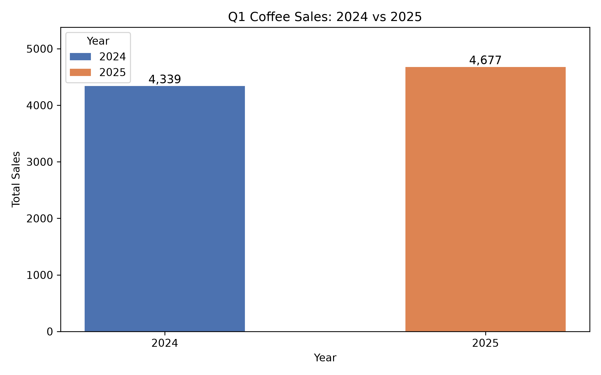
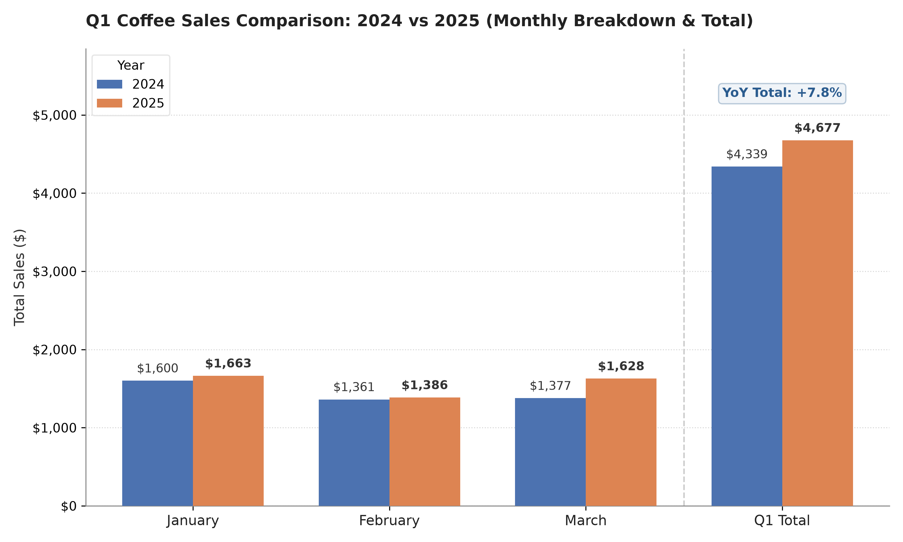
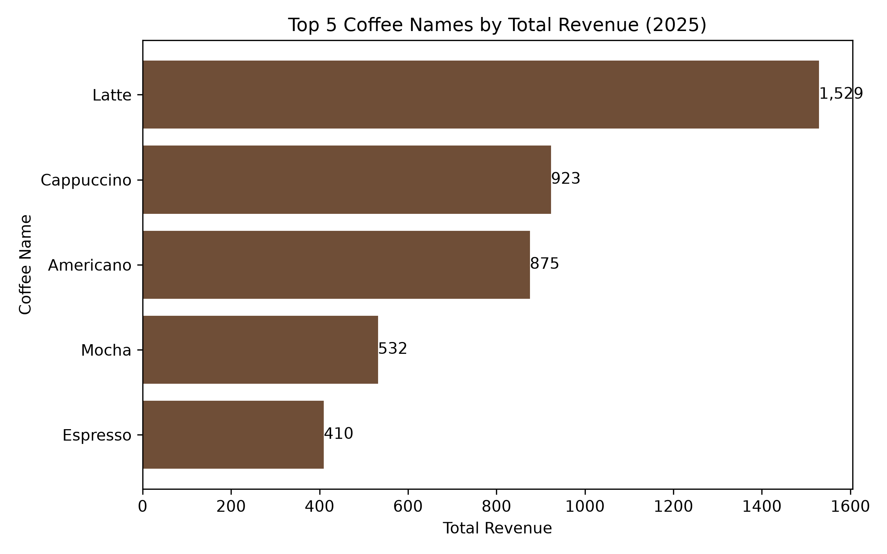
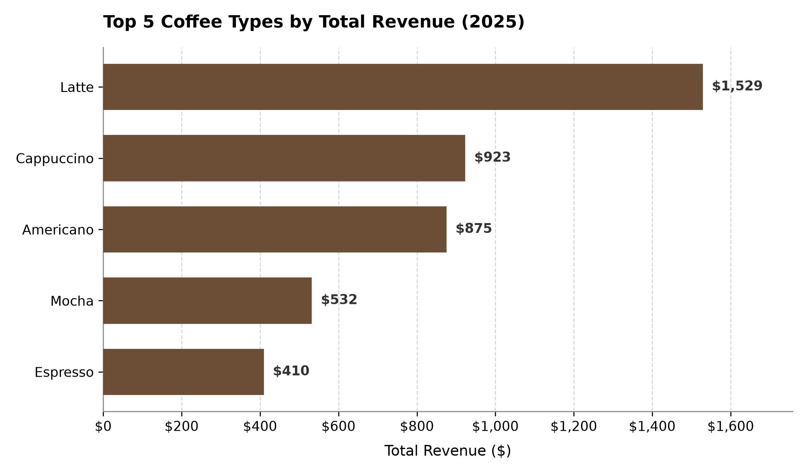
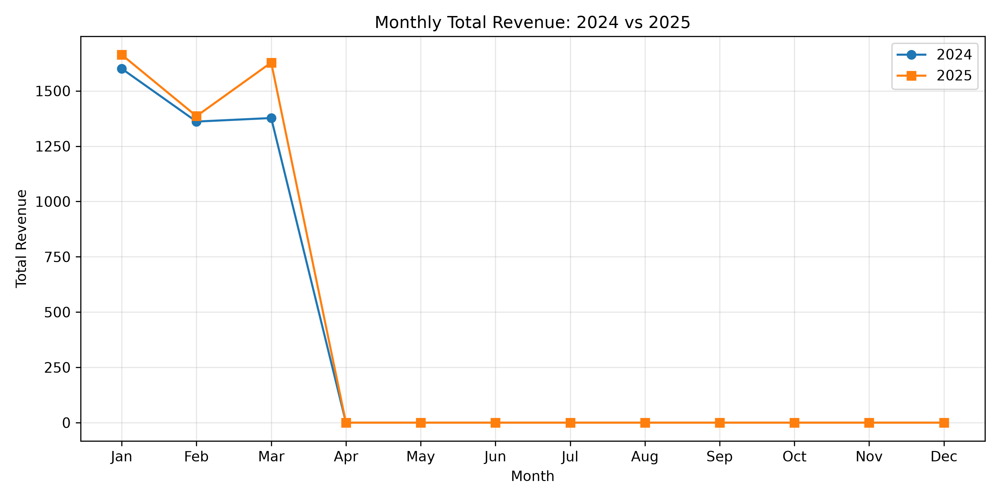
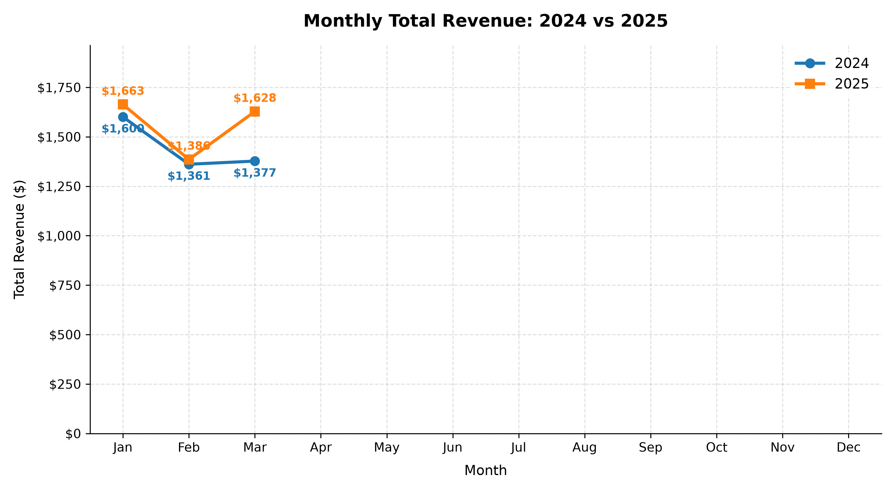

# Agentic AI: Automated Chart Generation with Reflection Pattern

## Project Summary

This project is a small AI agent. It makes charts from a coffee sales dataset.

The agent works in four steps:

1. A model writes Python code to make a chart. This is the first version (V1).
2. The code runs and saves the first chart.
3. A second model looks at the chart and the code. It writes feedback. This is called **reflection**.
4. The agent fixes the code and makes a better chart. This is the second version (V2).

**What I built:**

- A helper module (`utils.py`) to load the data and call the AI models.
- Setup with a `.env` file. I can change the provider and the models without changing the code.
- Three experiments with different prompts. The results are below.

**What I learned:**

- A second model can find mistakes in a chart. In experiment 3, the first chart showed zero sales for April to December. The reflection step found this and fixed it.
- Model choice matters. Some models are not available in every provider, so I tested the setup before I ran the experiments.

**Note:** The notebook comes from the DeepLearning.AI course. The dataset is synthetic and only covers January to March 2024 and 2025.

An implementation of the **Reflection Design Pattern** in Agentic AI workflows. This project demonstrates how a multi-modal Large Language Model (LLM) can autonomously critique its own generated data visualizations, identify layout bugs or styling flaws, and iteratively refine Python plotting code to produce publication-ready charts.

---

## 🏗️ Architecture & Workflow

The pipeline executes a 4-step autonomous agentic loop:

1. **Code Generation (V1):** An LLM receives the dataset schema and a natural language instruction, outputting raw Matplotlib code wrapped in custom `<execute_python>` tags.
2. **Execution (V1):** The generated code is extracted from the tags and executed in-process against the DataFrame (`df`), rendering the initial chart (`chart_v1.png`).
3. **Multimodal Reflection & Critique:** A stronger vision-capable LLM analyzes both the generated chart image and the raw code, evaluating visual clarity, axis labels, legends, and aesthetic hierarchy. It outputs structured JSON feedback alongside revised code.
4. **Refinement & Execution (V2):** The refined code is extracted and executed to generate a polished, production-grade visualization (`chart_v2.png`).

---

## 📊 Visual Comparison: V1 vs. V2

*The reflection loop corrects common LLM charting mistakes, such as overlapping axis labels, poor color choices, or improper datetime handling.*

| Initial Draft (V1) | Refined Output (V2) |
| :---: | :---: |
|  |  |

---

## 🧪 Experiments

I ran the same `run_workflow` function from the notebook with three different prompts. Each run used the same models:

- Generation: `glm-5.3-flash`
- Reflection: `gemini-4-argon`
- Provider: OpenCode Go (set in `.env`)

Values in the charts were checked against `coffee_sales.csv`.

### Experiment 1: Q1 2024 vs 2025 (course prompt)

Prompt: *"Create a plot comparing Q1 coffee sales in 2024 and 2025 using the data in coffee_sales.csv."*

| Initial Draft (V1) | Refined Output (V2) |
| :---: | :---: |
|  |  |

- **Feedback:** V1 is a simple two-bar chart with no monthly detail. The reflection asked for a monthly breakdown, currency format, and a year-over-year change.
- **Result:** V2 shows January, February, and March for both years, plus the Q1 total. Q1 2024 was $4,339 and Q1 2025 was $4,677, a change of +7.8%.

### Experiment 2: Top 5 coffee names in 2025

Prompt: *"Create a horizontal bar chart of the top 5 coffee_name values by total revenue (sum of price) in 2025."*

| Initial Draft (V1) | Refined Output (V2) |
| :---: | :---: |
|  |  |

- **Feedback:** The label of the top bar touched the edge of the bar, and the labels had no padding. The reflection asked for cleaner spines and a grid.
- **Result:** V2 uses `$` labels with spacing. The values are Latte $1,529, Cappuccino $923, Americano $875, Mocha $532, and Espresso $410.

### Experiment 3: Monthly revenue, 2024 vs 2025

Prompt: *"Create a line chart of monthly total revenue (sum of price) for 2024 and 2025 on the same axes, with month on the x-axis from Jan to Dec."*

| Initial Draft (V1) | Refined Output (V2) |
| :---: | :---: |
|  |  |

- **Feedback:** The code filled April to December with zero, which made it look like sales dropped to zero. The reflection noticed this and asked to use `NaN` for months with no data.
- **Result:** V2 stops the lines at March, which matches the data. The data labels in V2 touch the lines a little. This is a minor issue I did not fix.

### Model changes log

| Stage | Generation model | Reflection model | Provider | Status |
| :--- | :--- | :--- | :--- | :--- |
| Course default | `gpt-4o-mini` | `gpt-5-mini` | OpenAI | Not run. OpenCode does not offer these models. |
| First OpenCode attempt | `gpt-5.4-mini` | `claude-sonnet-4-6` | OpenCode Zen | Not run. They were listed, but Go does not include them. |
| Current | `glm-5.3-flash` | `gemini-4-argon` | OpenCode Go | All three experiments run. |

The current models are set in `.env` with `MODELS=glm-5.3-flash,gemini-4-argon`, so you can test other models without changing the code.

---

## 🛠️ Tech Stack & Concepts

* **Languages:** Python
* **Data Manipulation & Plotting:** Pandas, Matplotlib
* **Design Patterns:** Agentic Reflection, Multi-Model LLM Workflows
* **Model Integration:** OpenAI-compatible chat completions (OpenCode Go, OpenAI, OpenRouter) and the Anthropic Messages API for multimodal vision payloads
* **Tooling:** Regular expression extraction, in-process code execution, automated JSON parsing for model feedback

---

## 🚀 Getting Started

### Prerequisites
* Python 3.10+
* [uv](https://docs.astral.sh/uv/) (recommended) or a standard `venv` + `pip` setup
* An API key for an OpenAI-compatible provider (OpenCode Go by default)

### Installation & Execution

1. Clone the repository:

   ```bash
   git clone https://github.com/haliercesr/agentic-ai-reflection-pattern-chart-generation.git
   cd agentic-ai-reflection-pattern-chart-generation
   ```

2. Create a virtual environment and install dependencies.

   With `uv` — no global `pip` required:

   ```bash
   uv venv .venv --python 3.13
   source .venv/bin/activate        # Windows: .venv\Scripts\activate
   uv pip install -r requirements.txt
   ```

   `uv` does not install `pip` inside the environment. Use `uv pip` for every
   install, or run `uv pip install pip` if you need the classic command.

   With the standard library tooling:

   ```bash
   python -m venv .venv
   source .venv/bin/activate        # Windows: .venv\Scripts\activate
   python -m pip install -r requirements.txt
   ```

   `python -m pip` works even when the `pip` command is not on your `PATH`.

3. Configure credentials:

   ```bash
   cp .env.example .env
   ```

   Then edit `.env`. The default provider is OpenCode Go:

   ```dotenv
   OPENCODE_API_KEY=oc_sk_...
   MODELS=glm-5.3-flash,gemini-4-argon
   ```

   `MODELS` is an ordered comma-separated list: the first entry generates the
   initial code, the second performs the vision-based reflection. A single entry
   is reused for both steps, and `GENERATION_MODEL` / `REFLECTION_MODEL` override
   it per step.

   `.env.example` documents how to point the same notebook at OpenAI, OpenRouter,
   OpenCode Zen, or any other OpenAI-compatible gateway.

4. Launch the notebook:

   ```bash
   jupyter lab M2_UGL_1.ipynb
   ```

Run the cells top to bottom. The workflow writes `chart_v1.png` and `chart_v2.png`
to the working directory.

---

## 📁 Data

`coffee_sales.csv` is synthetic sample data generated for reproducibility. Replace it with the course dataset to reproduce the original results.

---

## ⚠️ Notes

* `run_generated_code` executes model-generated code in-process with `exec()`. It is
  **not** a sandbox. Only run it on code you are willing to execute.
* Default models: `glm-5.3-flash` for generation and `gemini-4-argon` for reflection.
  Both come from `MODELS` in `.env`, so you can swap them without touching the notebook.
* The reflection step requires a **vision-capable** model. Text-only models fail when
  the chart image is sent.


